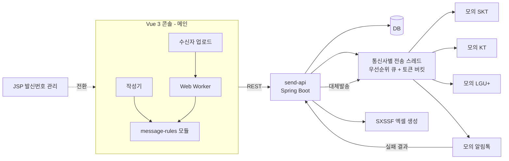
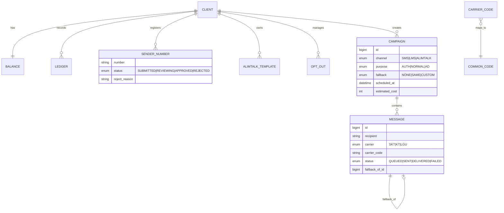
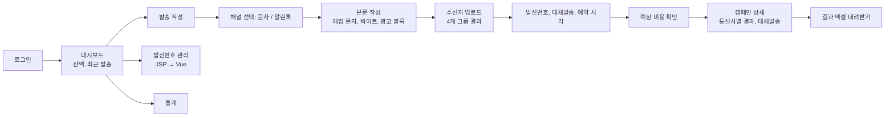

# 프로젝트 기획서: sendwise, 기업 메시징 발송 콘솔

## 0. 작성 원칙

- 기존 이력서, 포트폴리오, 자기소개서(base, v1)에 나온 문제와 기법은 쓰지 않아요.
- 문제는 기업 메시징 도메인에서만 생기는 것으로 골라요. 문자 바이트 규칙, 발신번호 사전등록, 광고 문자 규제, 알림톡 템플릿과 대체발송, 선불 잔액, 통신사 결과코드, 대량 결과 내려받기가 여기에 들어가요.
- 슈어엠 내부 구조는 공개된 정보가 없어요. 기술 선택은 공고 스택(Vue/React, Java, JSP, Spring Boot)과 일반적인 메시징 서비스 규칙을 기준으로 해요.

## 1. 한 줄 정의

고객사 담당자가 문자와 알림톡을 작성하고 규제와 잔액을 확인한 뒤 보내고, 통신사별 결과를 확인하는 발송 콘솔이에요.

- **메인 (Vue 3)**: 메시지 작성기, 수신자 업로드, 발신번호 등록, 알림톡 템플릿과 대체발송 설정, 결과 통계
- **서브 (Java, Spring Boot, JSP)**: 발송 API, 모의 통신사 연동, 잔액 차감, 대체발송 처리, 결과 엑셀 내려받기, JSP 관리 화면 전환

## 2. 공고와의 연결

| 공고 | 요구 | 이 프로젝트에서 다루는 부분 | 비중 |
|---|---|---|---|
| 프론트엔드 개발자 (Vue / React) | Vue 또는 React | Vue 3 콘솔 전체 | 메인 |
| 병역특례 웹개발자 (Java / JSP) | JAVA/JSP 웹앱 개발 | Spring Boot API, JSP 관리 화면 | 서브 |
| 같은 공고 | 레거시 유지보수, 리팩토링 | JSP 발신번호 관리 화면을 Vue로 전환 | 서브 |
| 같은 공고 | 고객사 연동 기술 지원, 오류 조치 | 통신사별 결과코드를 공통 코드와 조치 안내로 변환 | 메인 + 서브 |
| 회사 서비스 | SMS/LMS/MMS, 카카오 알림톡, 080 수신거부, 통계 대시보드 | 작성기, 알림톡 대체발송, 광고 규제, 통계 | 메인 |

## 3. 서비스 맥락에서 생기는 실제 문제

### 프론트엔드 (메인)
1. **문자 깨짐과 유형 오판**: 통신사 문자는 EUC-KR(KS X 1001 완성형) 기준이에요. 완성형에 없는 한글(예: 똠, 햏)이나 이모지를 넣으면 수신 단말에서 `?`로 깨져요. 바이트 계산도 틀려서 90바이트 SMS인 줄 알았던 문자가 LMS로 과금돼요.
2. **수신자 파일 정리**: 고객사가 올리는 엑셀과 CSV에는 `010-1234-5678`, `01012345678`, `+82 10 1234 5678`이 섞여 있어요. 중복 번호와 수신거부 번호도 섞여 있어요. 정리하지 않으면 같은 사람에게 두 번 가거나, 거부한 사람에게 광고가 나가요.
3. **발신번호 사전등록**: 전기통신사업법에 따라 등록하지 않은 번호로는 보낼 수 없어요. 서류 심사 중인 번호를 작성 화면에서 고를 수 있으면 발송 단계에서 전부 실패해요.
4. **광고 문자 규제**: 광고 문자에는 `(광고)` 표기, 업체명, 무료 수신거부 번호가 들어가야 해요. 21시부터 다음 날 8시까지는 보낼 수 없어요. 빠뜨리면 고객사가 과태료 대상이 돼요.
5. **알림톡 템플릿 불일치**: 알림톡은 승인된 템플릿과 본문이 일치해야 나가요. 변수 치환 결과가 템플릿과 어긋나면 발송에 실패해요. 이때 문자로 대체발송할지, 대체 문구를 무엇으로 할지 정해야 해요.
6. **잔액 부족**: 선불 고객사는 잔액보다 많이 보내면 일부만 나가요. 발송 전에 예상 비용(유형별 단가 × 건수)을 보여 주고 막아야 해요.
7. **결과코드 해석**: 통신사마다 실패 코드 체계가 달라서, 고객사 담당자는 코드만 보고 원인을 알 수 없어요.

### 백엔드와 레거시 (서브)
8. **잔액 동시 차감**: 같은 고객사의 여러 담당자가 동시에 보내면 잔액이 음수가 될 수 있어요.
9. **대체발송 처리**: 알림톡 실패 결과를 받으면 정해진 시간 안에 문자로 다시 보내야 하고, 비용도 문자 단가로 다시 계산해야 해요.
10. **인증 문자 지연**: 대량 광고 캠페인이 통신사 전송 한도를 차지하면 인증번호 문자가 늦어져요.
11. **대량 결과 내려받기**: 100만 건 결과를 엑셀로 만들면 서버 메모리가 부족해져요.
12. **JSP 관리 화면**: 발신번호 관리가 JSP 폼과 전체 페이지 새로고침 구조라 콘솔과 사용 경험이 달라요.

## 4. 영향

- 고객사: 문자 깨짐, 예상과 다른 과금, 규제 위반은 바로 민원과 비용으로 이어져요.
- 운영: 결과코드를 해석해 주는 문의가 반복돼요.
- 비즈니스: 인증 문자 지연은 고객사 서비스 장애로 보여요.

## 5. 해결 방향

- 규칙은 화면마다 따로 두지 않고 순수 함수 모듈 하나(`message-rules`)에 모아요. 작성기, 업로드, 예약 화면이 같은 모듈을 써요. 서버도 같은 규칙 표를 가지고 한 번 더 검사해요. 규칙 표와 경계 테스트 케이스는 모노레포의 `packages/rules`에 JSON으로 두고, Vitest와 JUnit이 같은 파일을 읽어요.
- 무거운 파일 처리는 브라우저의 별도 스레드로 옮겨요.
- 서버는 잔액과 대체발송을 상태 전이로 관리하고, 전송 한도는 통신사별로 나눠요.

## 6. 기술적 해결 방법

### 6-1. 메시지 작성기 (메인)
- EUC-KR 완성형 2,350자 표를 내장해서 입력 즉시 완성형 밖 문자를 강조하고, 대체 문자를 제안해요.
- 바이트 계산 함수: 완성형 한글 2바이트, ASCII 1바이트예요. SMS 90바이트, LMS 2,000바이트 경계에서 유형을 바꾸고, 바뀌는 순간 단가 차이를 보여 줘요.
- 개인화 변수(`#{이름}`)는 업로드한 수신자 중 가장 긴 값으로 치환해 최대 바이트를 계산해요.
- 고려했다가 버린 대안: `TextEncoder`는 UTF-8만 지원해서 EUC-KR 바이트를 계산할 수 없어요.

### 6-2. 광고 규제 검사 (메인 + 서브)
- 광고로 선택하면 `(광고)`, 업체명, 무료 수신거부 문구를 본문 앞뒤에 고정 블록으로 붙이고 지울 수 없게 해요.
- 예약 시각 선택기에서 21시~8시를 고를 수 없게 막아요. 서버도 같은 규칙으로 거절해요.
- 규칙 표(시간대, 필수 문구)는 서버 API로 내려받아 프론트와 서버가 같은 값을 써요.

### 6-3. 수신자 업로드 (메인)
- Web Worker에서 SheetJS로 엑셀과 CSV를 읽어요.
- 번호 정규화(국가번호, 하이픈, 공백 제거), 형식 검증, 중복 제거, 080 수신거부 대조를 Worker 안에서 처리해요.
- 결과를 유효, 형식 오류, 중복, 수신거부 4개로 나눠 건수와 예시를 보여 주고, 오류 행만 엑셀로 내려받게 해요.

### 6-4. 발신번호 등록 흐름 (메인 + 서브)
- 상태: `미등록 → 서류 제출 → 심사 중 → 승인 / 반려`
- 작성 화면의 발신번호 선택에는 승인된 번호만 나와요. 반려 사유는 등록 화면에 보여 줘요.

### 6-5. 알림톡 템플릿과 대체발송 (메인 + 서브)
- 템플릿 본문과 변수 위치를 파싱해서, 변수를 치환한 미리보기와 템플릿 일치 여부를 작성 단계에서 보여 줘요.
- 대체발송 설정: 끄기, 같은 문구로 문자 발송, 별도 문구로 문자 발송 중 하나를 골라요. 별도 문구에도 6-1 바이트 규칙을 그대로 적용해요.
- 서버는 알림톡 실패 결과를 받으면 대체발송 메시지를 만들고, 원본과 대체 건을 연결해 결과 화면에서 같이 보여 줘요.

### 6-6. 예상 비용과 잔액 (메인 + 서브)
- 작성 화면에서 유형별 단가 × 유효 건수(대체발송 최대치 포함)로 예상 비용을 보여 줘요. 잔액보다 크면 발송 버튼을 막고 부족 금액을 보여 줘요.
- 서버는 `UPDATE balance SET amount = amount - :cost WHERE client_id = :id AND amount >= :cost`처럼 조건부 차감을 해요. 영향받은 행이 0이면 거절해요.
- 실패 건과 대체발송 차액은 결과 확정 뒤 환급 원장(`ledger`)에 기록해요.

### 6-7. 결과코드 변환과 통계 (메인 + 서브)
- 통신사별 결과코드를 공통 코드(성공, 결번, 수신거부, 단말 꺼짐, 스팸 차단, 기타)로 매핑하는 표를 서버에 둬요.
- 화면에는 공통 코드, 설명, 고객사가 할 수 있는 조치를 같이 보여 줘요.
- 통계는 ECharts로 통신사별, 유형별, 공통 코드별 실패율을 보여 줘요.

### 6-8. 통신사 전송과 인증 문자 우선 (서브)
- 모의 통신사 3개(SKT, KT, LGU+ 역할)를 두고, 통신사별로 초당 전송 한도를 설정해요.
- 통신사별 전송 스레드가 우선순위 큐(인증 > 일반 > 광고)에서 꺼내 토큰 버킷(Bucket4j) 한도 안에서 보내요.

### 6-9. 대량 결과 내려받기 (서브)
- Apache POI `SXSSFWorkbook`으로 행을 디스크에 흘려 쓰면서 엑셀을 만들어요. 메모리에는 일정 행 수만 올려요.
- 만드는 동안 화면은 작업 상태를 보여 주고, 완료되면 내려받기 링크를 줘요.

### 6-10. JSP → Vue 전환 (서브)
- 발신번호 관리를 Spring MVC + JSP로 먼저 만들고, Cypress 시나리오를 작성해요.
- 같은 기능을 REST API와 Vue 화면으로 만든 뒤 해당 URL만 Vue로 넘기고, 같은 시나리오를 다시 돌려요.

## 7. 저장소 구조 (모노레포)

저장소 하나(`cyjoon68/sendwise`)에 프론트, 백엔드, 공유 규칙을 같이 둬요.

```
sendwise/
├── apps/
│   ├── frontend/         # Vue 3 콘솔 (Vite, npm workspaces)
│   ├── api/              # Spring Boot 3 API + JSP 발신번호 관리 (Gradle)
│   └── carrier-mock/     # 모의 SKT/KT/LGU+, 모의 알림톡 (Gradle)
├── packages/
│   └── rules/            # 규칙 표와 경계 테스트 케이스 (JSON)
│       ├── message-rules.json   # 바이트 경계, 광고 금지 시간대, 필수 문구, 단가
│       ├── ksx1001.json         # 완성형 2,350자 표
│       ├── carrier-codes.json   # 통신사 결과코드 → 공통 코드
│       └── cases/*.json         # 프론트와 서버가 같이 돌리는 테스트 케이스
├── docs/
│   ├── plan.md
│   └── measurements/
├── settings.gradle       # api, carrier-mock 멀티 프로젝트
├── package.json          # frontend workspace
└── compose.yaml          # MySQL, api, carrier-mock
```

**모노레포로 묶는 이유**
- 규칙이 바뀌면 `packages/rules` 한 곳만 고쳐요. 프론트와 서버 테스트가 한 PR에서 같이 깨지고 같이 고쳐져요. 저장소를 나누면 규칙 버전이 어긋나도 알아채기 어려워요.
- Java와 TypeScript는 코드를 공유할 수 없어서, 코드 대신 데이터(JSON)를 공유해요.
- API 변경과 콘솔 변경을 한 커밋으로 묶을 수 있어요.

**빌드와 CI**
- Gradle 멀티 프로젝트(`api`, `carrier-mock`)와 npm workspaces(`frontend`)를 루트에서 각각 실행해요.
- CI는 변경 경로 필터로 나눠요. `apps/frontend/**`면 프론트 잡, `apps/api/**`면 백엔드 잡, `packages/rules/**`면 둘 다 돌아요.

## 8. 아키텍처



## 9. 데이터 모델



## 10. API 명세 (핵심)

| 메서드 | 경로 | 설명 |
|---|---|---|
| GET | `/v1/rules` | 바이트 경계, 광고 금지 시간대, 필수 문구, 단가 |
| POST | `/v1/campaigns` | 캠페인 생성 (규제, 잔액 검사 후 차감) |
| GET | `/v1/campaigns/{id}` | 상태별 건수, 대체발송 건수 |
| GET | `/v1/campaigns/{id}/messages?status=FAILED&page=` | 실패 건 (공통 코드, 조치 안내 포함) |
| POST | `/v1/campaigns/{id}/exports` | 결과 엑셀 생성 작업 시작 |
| GET | `/v1/exports/{id}` | 작업 상태, 내려받기 링크 |
| CRUD | `/v1/sender-numbers` | 발신번호 등록과 심사 상태 (JSP 전환 대상) |
| GET | `/v1/alimtalk-templates` | 승인된 템플릿과 변수 |
| GET | `/v1/stats?from=&to=&groupBy=carrier|code` | 통계 |
| POST | `/carrier/{carrier}/results` | 모의 통신사 결과 수신 |

## 11. 화면 흐름



## 12. 측정 지표

| 지표 | 측정 방법 | 비교 |
|---|---|---|
| 완성형 밖 문자 검출 | 테스트 케이스(완성형 밖 한글, 이모지, 특수기호) 통과 수 | 검출 누락 0 |
| 바이트 경계 | 89, 90, 91, 1,999, 2,000, 2,001바이트 케이스 | 유형 판정 오류 0 |
| 수신자 10만 행 업로드 | 파일 선택부터 4개 그룹 결과 표시까지 시간, 처리 중 입력 반응 | 메인 스레드 처리 vs Worker |
| 광고 규제 | 금지 시간대, 필수 문구 누락 케이스를 프론트와 서버에서 각각 거절 | 통과 건 0 |
| 잔액 동시 차감 (서브) | 같은 고객사 동시 발송 100건 nGrinder 시나리오 | 음수 잔액 0 |
| 인증 문자 대기 (서브) | 광고 10만 건 진행 중 인증 문자 큐 대기 p95 | 우선순위 큐 전후 |
| 결과 엑셀 100만 행 (서브) | 힙 최대 사용량, 생성 시간 | `XSSFWorkbook` vs `SXSSFWorkbook` |
| JSP 전환 (서브) | 같은 Cypress 시나리오 통과 수 | 전환 전후 |

목표치는 기획 단계의 기준이에요. 이력서에는 실제로 측정한 값만 써요.

## 13. 테스트

- 공통: `packages/rules/cases`를 Vitest와 JUnit이 같이 읽어 같은 결과를 내는지 확인
- 메인: Vitest(`message-rules` 바이트, 문자표, 규제), Vue Testing Library(작성기, 업로드 결과), Cypress(발송 전체 흐름)
- 서브: JUnit 5 + Testcontainers(조건부 차감, 대체발송 상태 전이, 결과코드 매핑), nGrinder(동시 차감, 우선순위)

## 14. MVP 범위

포함
- 작성기(깨짐 문자, 바이트, 광고 블록), 수신자 업로드, 발신번호 등록 흐름, 알림톡 템플릿과 대체발송, 예상 비용, 결과코드 변환, 통계
- 발송 API, 모의 통신사 3개와 모의 알림톡, 잔액 차감과 환급, 우선순위 전송, 엑셀 내려받기
- JSP 발신번호 관리와 Vue 전환

제외
- 실제 통신사, 카카오 연동, 결제(충전), MMS 이미지, 국제 발송, RCS, 다중 사용자 권한

## 15. 기술 스택

- 메인: Vue 3, TypeScript, Vite, Pinia, Vue Router, VeeValidate, SheetJS, ECharts, Web Worker
- 서브: Java 21, Spring Boot 3, Spring MVC + JSP, Spring Data JPA, MySQL 8, Bucket4j, Apache POI
- 테스트: Vitest, Vue Testing Library, Cypress, JUnit 5, Testcontainers, nGrinder

DB(MySQL)는 슈어엠이 쓰는지 확인하지 못했어요. Java 진영에서 흔히 쓰는 선택이에요.

## 16. 작업 분해

| 순서 | 작업 | 영역 | 완료 기준 | 예상 |
|---|---|---|---|---|
| 1 | 모노레포 골격(Gradle 멀티 프로젝트, npm workspaces, `packages/rules`), compose, 경로별 CI | 공통 | 한 명령으로 기동, 경로별 CI 잡 분리 | 0.5일 |
| 2 | 도메인 모델, 규칙 API, 결과코드 매핑 표 | 서브 | 통합 테스트 통과 | 1일 |
| 3 | `message-rules` 모듈(문자표, 바이트, 광고 규제) | 메인 | 경계 테스트 전부 통과 | 1.5일 |
| 4 | 작성기 화면(깨짐 강조, 유형 전환, 광고 블록, 미리보기) | 메인 | 규칙 위반 시 발송 버튼 비활성 | 1.5일 |
| 5 | 수신자 업로드 Worker와 4개 그룹 결과 | 메인 | 10만 행 전후 측정값 기록 | 1.5일 |
| 6 | 발신번호 등록 흐름(JSP 먼저) + Cypress 시나리오 | 서브 | 상태 전이 동작 | 1일 |
| 7 | 알림톡 템플릿 미리보기, 대체발송 설정 | 메인 | 템플릿 불일치 강조 | 1일 |
| 8 | 예상 비용, 잔액 조건부 차감, 환급 원장 | 메인 + 서브 | 동시 차감 음수 0 | 1.5일 |
| 9 | 통신사별 전송 스레드, 우선순위 큐, 대체발송 처리 | 서브 | 인증 문자 대기 전후 측정 | 1.5일 |
| 10 | 캠페인 상세, 결과코드 설명과 조치 안내, 통계 | 메인 | 공통 코드별 실패율 표시 | 1.5일 |
| 11 | 결과 엑셀 SXSSF 내려받기 | 서브 | 100만 행 힙 전후 측정 | 1일 |
| 12 | 발신번호 관리 Vue 전환 | 서브 | 같은 Cypress 시나리오 통과 | 1일 |
| 13 | 측정 정리, README | 공통 | 측정값과 재현 명령어 문서화 | 1일 |

합계 약 15.5일(하루 6시간 기준)이에요. 메인 약 9일, 서브 약 5일, 공통 1.5일이에요.

## 17. 이력서에 남길 근거

메인
- EUC-KR 완성형 밖 문자 검출과 바이트 경계 판정으로 깨짐과 유형 오판 0
- 수신자 10만 행 정리를 Worker로 옮긴 전후 처리 시간과 입력 반응
- 광고 규제를 프론트와 서버의 같은 규칙 표로 검사
- 알림톡 템플릿 불일치 사전 표시와 대체발송 설정
- 통신사 결과코드를 공통 코드와 조치 안내로 변환

서브
- 조건부 차감으로 동시 발송 시 음수 잔액 0
- 우선순위 큐로 광고 캠페인 중 인증 문자 대기 감소
- SXSSF로 100만 행 엑셀 생성 시 힙 사용량 감소
- JSP 발신번호 관리를 Vue로 전환하고 같은 시나리오 통과

## 18. 구현 지시서 (에이전트용)

1. 작업 분해 순서대로 진행하고, 각 단계 완료 기준을 테스트나 측정값으로 남긴다.
2. 기존 이력서와 포트폴리오에 나온 기법을 끌어오지 않는다. 필요해 보이면 먼저 사용자에게 묻는다.
3. 측정값은 `docs/measurements/`에 명령어, 환경, 원본 출력과 함께 저장한다.
4. 목표치를 못 맞춘 지표는 수치를 바꾸지 말고 실제 값과 원인을 기록한다.
